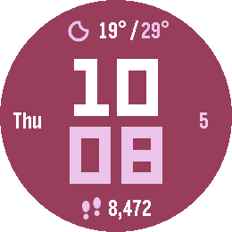
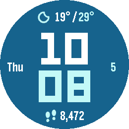
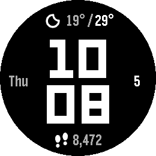
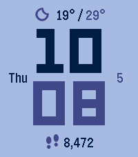
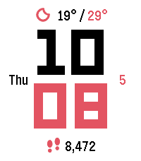
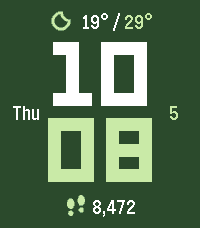

# Shore

*Big digits, the weather, the date and your steps.*

     

A Pebble watchface (v1.0.0) for Pebble Round 2 (gabbro) and Pebble Time 2 (emery).

Shore is the everyday sibling of [Coast](https://github.com/ProggroP/Coast): the
same large LECO 1976 digits, hours above minutes, but accurate to the minute
and with the information you glance at during the day.

## What the face shows

| Position | Content |
|---|---|
| Top | Weather symbol, today's low and high ([Open-Meteo](https://open-meteo.com), every 30 minutes, no account needed) |
| Left | Weekday, English or German |
| Right | Day of the month |
| Bottom | Steps today, with a footprint symbol |

## Settings

- **Template**: Noir (default), Classic, Swiss, Blush, Berry, Lavender, Mint,
  Navy, Ocean, Forest, Plum, Sport. A template sets all colours; changing a
  single colour afterwards switches to *Custom*.
- **Colours**: background, hours, minutes, text, highlights.
- **Show**: weather, weekday and date, steps.
- **Weekday**: English (`Mon`, `8,472`) or German (`Mo`, `8.472`).
- **Weather**: current conditions or today's forecast as the symbol; Celsius,
  Fahrenheit or automatic by phone region.

## Symbols

The weather symbols come from
[Weather Icons](https://erikflowers.github.io/weather-icons/) by Erik Flowers
and Lukas Bischoff (SIL Open Font License 1.1, see
`LICENSES/WeatherIcons-OFL.txt`), the footprints are drawn by
`tools/make_icons.py`. Both are reduced to four opacity levels; the watch
recolours them through their 2-bit palette.

```bash
python tools/make_icons.py --ttf path/to/weathericons-regular-webfont.ttf
```

## Building

```bash
pebble build
pebble install --emulator gabbro
```

`tools/theme_shots.py` sends the colour templates to a running emulator and
takes one screenshot per template (enable `SHORE_DEMO` in `src/c/shore.c` for
a fixed time and step count).

## License

MIT, see [LICENSE](LICENSE). The weather symbols are under the SIL OFL 1.1,
the LECO 1976 font under its own license.
